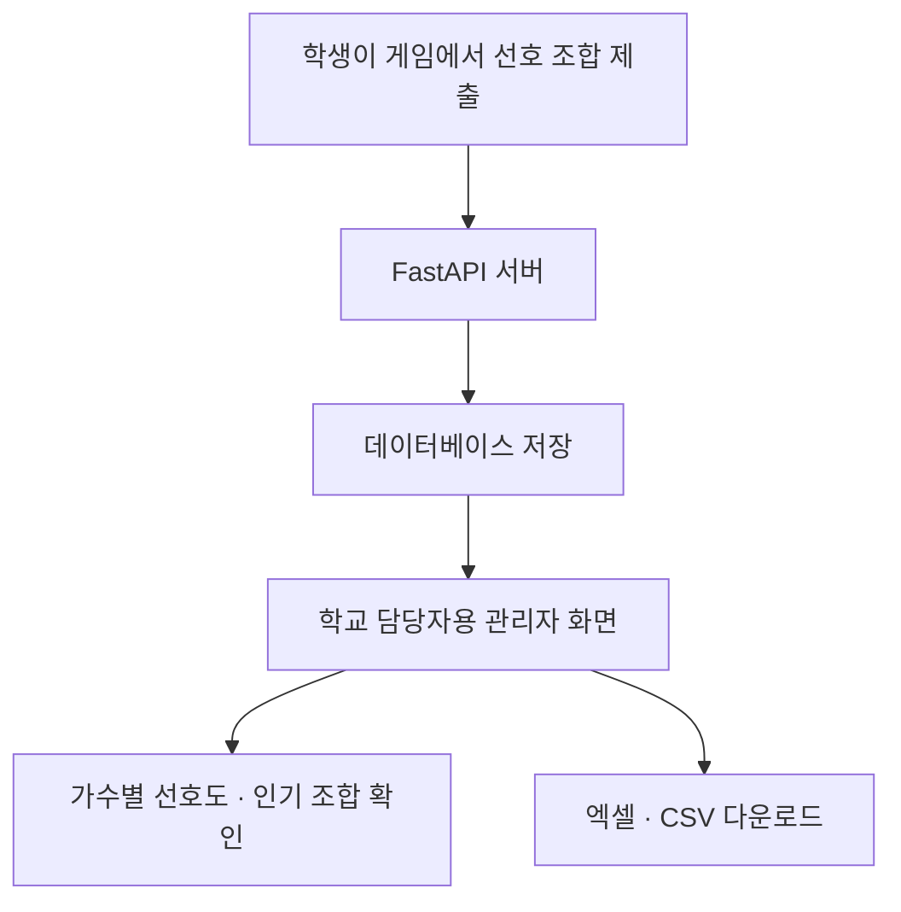

<div align="center">

**말로 세상을 바꾸다💬**

# Words to World

### 학생의 목소리로 만들어 가는 3D 대학 운영 시뮬레이션

인천대학교에서 진행한 바이브코딩 대회 출품작입니다.

**대회 일시 | 2026년 11월 6일 · 10:00~18:00 (KST)**


</div>

> **학생들의 말에 귀 기울이고, 나의 선택으로 캠퍼스를 바꾸다.**
>
> 캠퍼스 탐색 → 학생 요청 해결 → 학교 운영 → 나만의 축제

[🎮 게임 화면 열기](https://words-to-world-campus.xoxoi4023.chatgpt.site/) · [🎆 축제 스튜디오 열기](https://words-to-world-campus.xoxoi4023.chatgpt.site/festival.html)

## 프로젝트 개요

**Words to World는 인천대학교 송도캠퍼스를 배경으로 한 웹 기반 3D 대학 운영 게임입니다.** 나만의 학생 캐릭터를 만들고, 총장이 되어 캠퍼스 시설을 살펴보며 학생들의 요청에 대응합니다. 편의시설과 기숙사 운영을 결정하고, 예산·학생 만족도·학교 평판의 변화를 확인할 수 있습니다. 축제 스튜디오에서는 직접 라인업을 기획하고 자신의 캐릭터로 공연에 참여합니다.

인공지능대학 출범과 선후배 네트워킹 교류회를 맞아 열린 바이브코딩 대회의 취지에서 출발했습니다. 신입생과 재학생이 익숙한 학교를 게임으로 탐색하고, 학교 운영과 축제를 함께 상상할 수 있는 결과물을 만들었습니다.

별도 설치나 회원가입 없이 브라우저에서 플레이합니다. 실제 캠퍼스 지도와 시설 안내를 활용하며, 운영 금액·학생 요청·공연 비용과 연출은 게임용 설정입니다.

## 왜 만들었나요?

> “이번 축제에는 어떤 가수가 왔으면 좋겠다.”
> “불꽃놀이는 조금 더 늦은 시간에 했으면 좋겠다.”
> “이런 행사가 학교에서 열리면 재미있겠다.”

학생이라면 한 번쯤 떠올렸을 생각입니다. 저희는 **이런 의견을 더 재미있고 자연스럽게 표현할 수 있는 방법**을 고민했습니다. 설문조사나 건의함에 답하는 것에 더해, 즐겁게 참여하는 과정 자체가 자신의 선호를 표현하는 경험이 되기를 바랐습니다.

그래서 우리가 매일 수업을 듣고 생활하는 **인천대학교 송도캠퍼스를 게임의 무대**로 선택했습니다. 학생은 학교 운영자가 되어 시설을 관리하고, 선택에 따른 예산과 학생 반응의 변화를 경험합니다. 축제 스튜디오에서는 원하는 가수와 공연 순서, 장소와 폭죽을 조합하며 자신이 바라는 축제를 직접 만들어 봅니다.

저희가 지향하는 것은 **캠퍼스를 즐기는 경험에서 시작해, 학생의 목소리가 학교 행사 기획에 참고될 수 있는 참여 공간**입니다. 현재는 캠퍼스 운영과 축제 기획·체험을 구현했으며, 학생들의 선택을 모아 실제 기획에 활용하는 연결 구조를 다음 발전 방향으로 구상했습니다.

## 주요 기능

### 🏫 실제 캠퍼스를 탐색하는 3D 지도

- 송도캠퍼스 건물과 대운동장을 3D로 표현하고, 건물 이름표와 선택 강조로 위치를 안내합니다.
- 지도를 회전·이동·확대하며 건물이나 이름표를 누르면 시설 정보를 확인할 수 있습니다.
- 건물·매장 이름과 호관·호실로 검색하고, 시설 분류와 카페·식당 필터로 원하는 장소를 찾습니다.
- 학산도서관·7호관·강당의 상세 모델, 나무와 보행 학생, 계절별 색상과 낮·밤 조명으로 캠퍼스를 꾸몄습니다.

### 💬 학생들의 목소리에 응답하는 운영

- 건물 위 `!`를 눌러 시설별 요청을 확인하고, 비용과 효과를 비교해 조치를 선택합니다.
- 선택한 조치와 학생 반응은 다음 게임 날짜부터 반영됩니다. 오래 방치한 요청은 만족도와 평판에 영향을 줍니다.
- 시설 상태·생활 여건·학사 일정에 따라 민원과 칭찬이 달라지고, 문제의 심각도에 맞춰 대사가 바뀝니다.
- 분기별 즉시 조치 목표를 달성하면 학생 만족도와 학교 평판 보상을 받습니다.

### 📊 편의시설·기숙사와 학교 재정 관리

- **편의시설 32곳**의 직접 운영 또는 임대를 선택하고, 수익과 학생 편의성을 비교합니다.
- **기숙사 3곳**의 기숙사비 수준과 운영하는 방 비율을 조절하며 입주 인원·대기 인원·빈자리·유지비를 확인합니다.
- 다음 학기의 운영 계획을 세우고, 학기가 바뀌면 등록금·시설 수익·기숙사비·운영비가 정산됩니다.
- 운영 예산·학생 만족도·학교 평판을 대시보드에서 확인하고, 정산 장부와 학기별 A~D 평가로 운영 결과를 돌아봅니다.
- 운영 보고서의 추이 차트에서 지표와 기간을 선택하고 날짜별 변화·최고·최저 값을 살펴봅니다.

### 🎆 직접 기획하고 참여하는 축제 스튜디오

- 실제 가수 후보 중 **최대 3팀**을 선택하고 공연 순서, 장소, 총예산과 부가 구성을 정합니다.
- 예상 지출·남은 예산·게임용 예상 반응을 확인하며 기획안을 만들고, 브라우저에 저장한 여러 기획안을 비교합니다.
- 캠퍼스 위 3D 무대에서 가수별 무대 디자인과 노을·저녁·밤의 공연을 체험합니다.
- 폭죽의 시점과 하늘 위치를 고르고, 공연 전체 또는 폭죽만 미리 볼 수 있습니다.
- 관객 속으로 들어가거나 **내 학생 캐릭터로 입장**해 이동·점프·환호하고, 박자에 맞춰 응원봉을 흔듭니다. 공연 장면은 PNG로 저장할 수 있습니다.
- 게임에 설정된 축제 시즌에는 대운동장의 `!`에서 축제 화면으로 이동합니다. 축제 기획과 공연 체험은 학교 운영예산·만족도를 변경하지 않습니다.

공연 음악과 효과음은 Web Audio로 합성합니다. 실제 가수의 음원·목소리·안무를 재생하는 서비스가 아니며, 후보의 차트 표시는 제공 자료를 참고한 것으로 실시간 순위와는 구분됩니다.

### 👤 나만의 캐릭터와 이어지는 플레이

- 외형·이름·소속 단과대학·전공을 선택하고, 복수전공과 부전공까지 설정합니다.
- 캠퍼스의 프로필 카드와 축제 속 학생 캐릭터에 선택한 정보를 반영합니다.
- 2026년 3월 3일부터 시간을 진행·일시정지하고 1배속·2배속으로 플레이합니다. 학사 일정 달력에서 학교 일정을 확인할 수 있습니다.
- 자동 저장과 수동 저장·불러오기, 새 게임을 지원합니다. 저장 데이터는 해당 브라우저의 로컬 저장소에 보관됩니다.

## 향후 활용 방향 — 게임 속 선택을 학교 행사 기획으로

학생이 만든 축제 조합을 학교 담당자가 참고할 수 있도록, **선호 조합 제출과 집계 시스템**으로 확장하고자 합니다. 축제와 교내 행사에 맞춘 콘텐츠를 추가하고, 학교 자체 시스템과 연결할 때 적용할 구조입니다.



담당자는 학생들이 선택한 가수와 인기 조합을 확인하고, 집계 자료를 내려받아 행사 기획의 참고자료로 활용할 수 있습니다. 학생에게는 즐거운 참여 경험을, 학교에는 학생들의 선호를 살펴볼 수 있는 창구를 제공하는 것이 목표입니다.

> **현재 기능과 향후 구상**
>
> 현재 축제 기획안은 **해당 브라우저의 LocalStorage에만 저장**됩니다. 선호 조합의 외부 제출·수집, FastAPI 서버, 데이터베이스, 관리자 화면과 엑셀·CSV 내보내기는 **향후 확장 구상**이며 현재 서비스에는 포함되어 있지 않습니다.

## AI 협업 아키텍처 & 바이브 코딩 프로세스

이번 프로젝트는 여러 명이 **AI를 활용해 동시에 개발**하는 ‘바이브 코딩’ 방식으로 진행되었습니다. 각자의 AI 작업이 충돌하지 않도록, **개발 전 Markdown 문서로 공통 작업 기준을 설계**하고 협업했습니다.

- **역할 분담**: 캠퍼스 지도, 학교 운영, 축제 스튜디오 등 기능별로 역할을 나눴습니다. → [단계별 작업 단위](IMPLEMENTATION_PLAN.md#단계별-작업-단위)
- **작업 범위 제한**: 기능별 폴더와 브랜치를 구분하고, 다른 영역과 공통 파일의 수정 범위를 제한했습니다. → [작업 규칙](IMPLEMENTATION_PLAN.md#작업-규칙)
- **인터페이스 연결 방식**: 함수 이름·데이터 형식·이벤트를 사전에 정의해 각자 만든 기능을 연결했습니다. → [공통 약속](IMPLEMENTATION_PLAN.md#공통-약속)
- **검증 및 통합 절차**: 단계별 완료 기준과 로컬 실행 확인, 팀원의 PR 검토를 거쳐 통합했습니다. → [작업 시작·이어받기·넘기기](IMPLEMENTATION_PLAN.md#작업-시작이어받기넘기기) · [통합 확인과 공개](IMPLEMENTATION_PLAN.md#통합-확인과-공개)

> **핵심 철학**
>
> AI에 요청할 코드뿐 아니라, **여러 AI 작업의 범위와 연결·검토 절차까지 설계**했습니다.
>
> 공통 함수·인자·이벤트를 바꿔야 할 때는 AI가 임의로 변경하지 않고, **사람에게 먼저 알리고 규칙 문서를 수정한 뒤 코드에 반영**하도록 정했습니다. → [AI 도구로 작업할 때](IMPLEMENTATION_PLAN.md#ai-도구로-작업할-때)

전체 협업 기준과 단계별 완료 조건은 [공통 작업·구현 계획서](IMPLEMENTATION_PLAN.md)에서 확인할 수 있습니다.

## 기술 스택

| 구분 | 사용 기술과 역할 |
| --- | --- |
| 화면·게임 로직 | HTML5, CSS3, JavaScript ES Modules |
| 3D 렌더링 | Three.js, WebGL, OrbitControls |
| 데이터 | JSON 기반 캠퍼스·시설·운영·학생 대사·학사 일정·축제 설정 |
| 저장 | 브라우저 LocalStorage — 캐릭터, 게임 진행, 축제 기획안 |
| 시각화·사운드 | SVG 기반 운영 지표 차트, Web Audio API 합성 음악·효과음 |
| 검증 | Node.js 내장 테스트 러너 (`node:test`) |
| 로컬 실행 | Python 3 정적 HTTP 서버 |

Three.js는 저장소의 `vendor/`에 포함되어 있습니다. 별도의 패키지 설치·빌드·백엔드 서버나 AI API 키가 필요하지 않습니다. 학생 반응은 게임에 포함된 대사와 규칙으로 생성하므로, 플레이 중 외부 AI API 사용 비용이 발생하지 않습니다.

## 실행 방법 (Quick Start)

Python 3와 WebGL을 지원하는 최신 데스크톱 브라우저를 준비합니다.

```sh
git clone https://github.com/ehduq0221/words-to-world.git
cd words-to-world
python3 -m http.server 8000 --bind 127.0.0.1
```

- **대학 운영 게임:** <http://127.0.0.1:8000/>
- **축제 스튜디오 바로 체험:** <http://127.0.0.1:8000/festival.html>

### 처음 플레이한다면

1. 캐릭터의 외형과 전공을 선택하고 캠퍼스로 들어갑니다.
2. 건물이나 이름표를 눌러 시설을 살펴보고, 편의시설·기숙사의 다음 학기 운영 계획을 세웁니다.
3. `진행`을 눌러 시간을 흐르게 하고, 건물 위 `!`에서 학생 요청에 대응합니다.
4. 다음 날의 반응과 지표 변화를 확인하고, `메뉴`의 운영 보고서와 `정산 내역`으로 결과를 살펴봅니다.
5. 축제 시즌의 대운동장 `!` 또는 축제 스튜디오 주소로 들어가 나만의 축제를 기획하고 체험합니다.

### 조작법

| 화면 | 조작 | 동작 |
| --- | --- | --- |
| 캠퍼스 지도 | 마우스 왼쪽 드래그 | 지도 회전 |
| 캠퍼스 지도 | 마우스 오른쪽 드래그 | 지도 이동 |
| 캠퍼스 지도 | 마우스 휠 | 확대·축소 |
| 캠퍼스 지도 | 건물·이름표 클릭 | 시설 정보와 운영 메뉴 확인 |
| 캠퍼스 지도 | 건물 위 `!` 클릭 | 학생 요청 확인 · 축제 시즌에는 대동제 입장 |
| 시간 제어 | `진행` / 일시정지 · 배속 선택 | 게임 시간 진행·정지 및 1배속·2배속 전환 |
| 축제 관객 시점 | 방향키 또는 이동 버튼 | 관객석 이동 |
| 축제 체험 | `Space` | 점프하며 환호 |
| 축제 체험 | `F` / `L` | 박자에 맞춰 응원봉 흔들기 / 자유롭게 흔들기 |
| 축제 체험 | `P` | 공연 장면을 PNG로 저장 |

> **💾 저장 주의 — 접속 주소를 유지하세요.**
>
> `localhost`와 `127.0.0.1`은 **저장소를 공유하지 않습니다.** 같은 캐릭터와 진행 기록을 이어가려면 **동일한 브라우저·주소·포트**로 접속하세요.
>
> HTML 파일을 직접 열지 말고 위의 **HTTP 서버**를 통해 접속하세요.

### 코드 검증

Node.js가 설치된 환경에서 게임 로직과 축제 기획 데이터 테스트를 실행할 수 있습니다.

```sh
node --test tests/*.test.mjs src/festival/plans.test.mjs
```

캠퍼스 지도는 OpenStreetMap 자료를 활용합니다. 지도·시설 안내의 출처와 보정 내역은 [데이터 출처](public/data/SOURCE.md), 축제의 상세 조작과 구성은 [축제 스튜디오 안내](src/festival/README.md)에서 확인할 수 있습니다.
